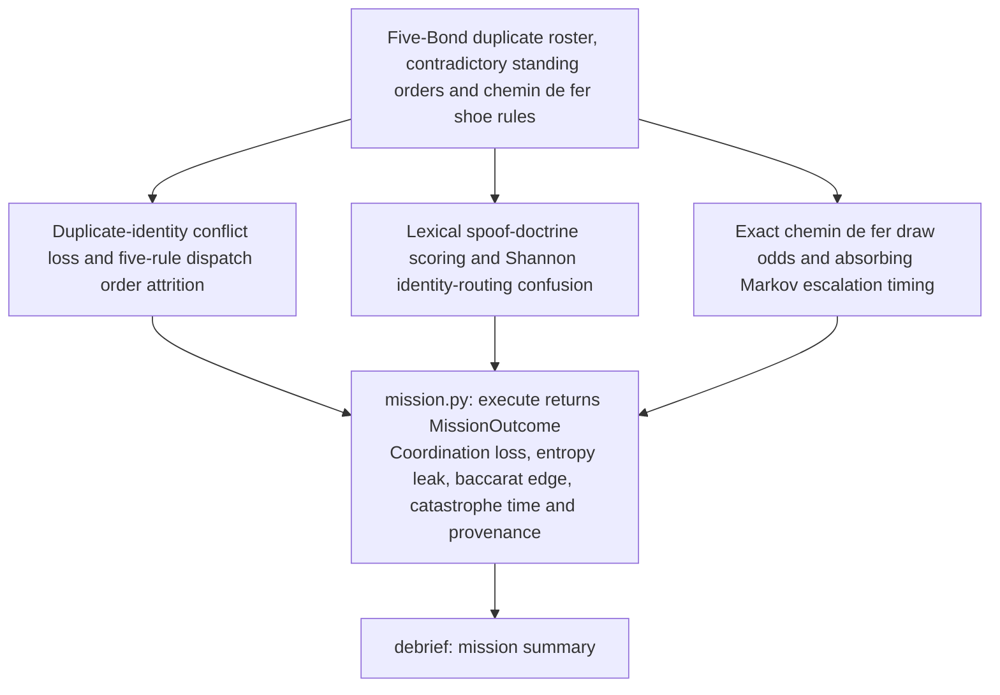

# Casino Royale (1967) — FIVE 00s · Special-Agent Mission Software

A **PROJECT BOND** film package. The 1967 *Casino Royale* is the spy farce in
which five operatives all answer to the codename *James Bond* — a coordination
catastrophe in the shape of a blockbuster. **FIVE 00s** models that farce
rigorously and deterministically, then exposes it through the frozen
`bond_api` mission protocol.

Tracked at <https://github.com/docxology/bond-casino_royale_1967>; drafted
inside the BOND suite as `projects/working/bond/casino_royale_1967`.

## Mission model



The branches group implemented capabilities; they do not imply a runtime order.

**Source map:** [`coordination_farce.py`](src/casino_royale_1967/coordination_farce.py), [`dispatch_chaos.py`](src/casino_royale_1967/dispatch_chaos.py); [`spoof_analyzer.py`](src/casino_royale_1967/spoof_analyzer.py), [`identity_confusion.py`](src/casino_royale_1967/identity_confusion.py); [`baccarat_table.py`](src/casino_royale_1967/baccarat_table.py), [`escalation_ladder.py`](src/casino_royale_1967/escalation_ladder.py); [`mission.py`](src/casino_royale_1967/mission.py).

## Film → software

Each concept in the film becomes a tested algorithm, not a themed stub.

| The film | The software |
|---|---|
| Five operatives, one codename | A duplicate-identity roster and a coordination-failure model with a weighted loss |
| Orders that contradict each other | A dispatch simulation that loses orders to five protocol rules |
| Standing orders played for laughs | A lexical analyzer scoring doctrine against a sane protocol |
| Nobody can tell the Bonds apart | An information-theoretic identity model measuring the loss in bits |
| The baccarat championship | Chemin de fer deal odds (exact for the infinite-deck model) and a birthday-bound table-collision metric (i.i.d. across hands) |
| A farce escalating to catastrophe | Doctrine as an absorbing Markov chain, timed against discipline |

## Modules

### Domain core — pure (stdlib + numpy), no `bond_api`, no `infrastructure`

| Module | What it computes |
|---|---|
| `src/casino_royale_1967/coordination_farce.py` | The five-Bond roster, task catalog and conflict graph; overlap, conflict and clearance-violation detection with a weighted coordination loss, plus single-agent deduplication as the remedy |
| `src/casino_royale_1967/dispatch_chaos.py` | A tick-based, priority-ordered dispatch centre enforcing five protocol rules (duplicate order, exclusive task, clearance, double-booking, duplicate codename), yielding violations, a chaos index and an event timeline |
| `src/casino_royale_1967/spoof_analyzer.py` | Word-boundary marker scoring, rule-inversion detection and oxymoron flagging over satirical ops doctrine, aggregated into a normalised spoof index |
| `src/casino_royale_1967/identity_confusion.py` | A softmax routing confusion matrix over agent features; Shannon entropy, conditional entropy, mutual information and NMI; Bayesian resolution of a dispatch sighting |
| `src/casino_royale_1967/baccarat_table.py` | Hand valuation and the full chemin de fer draw table; enumerated infinite-deck deal odds cross-validated against an independent brute force; the birthday-bound hand-collision probability, approximate because hands are combined as i.i.d. |
| `src/casino_royale_1967/escalation_ladder.py` | Doctrine as an absorbing Markov chain — fundamental matrix, expected absorption times, spectral radius, and the spoof-vs-sanctioned acceleration factor |

### Adapter and generation

| Module | Role |
|---|---|
| `src/casino_royale_1967/mission.py` | The single `bond_api` adapter — `MissionProvider`, gadget registry, deterministic provenance |
| `src/casino_royale_1967/manuscript_variables.py` | Live `{{TOKEN}}` hydration from `docs/manuscript/config.yaml` + the domain core, and the strict resolved-manuscript writer |
| `src/casino_royale_1967/figures/plots.py` | Six deterministic matplotlib figures, one per concept |

The domain core is genuinely independent of `bond_api`: the package
`__init__.py` resolves the adapter's exports lazily, and
`tests/test_layer_contract.py` proves the core imports with `bond_api` blocked
in a subprocess — carrying a positive control that asserts `mission.py` fails
under the same conditions, so the check cannot pass vacuously.

## The MissionProvider surface

`src/casino_royale_1967/mission.py` exposes the FROZEN `bond_api` contract that
`bond-cli`, the coordinator and the orchestrator consume across the fleet:

```python
from casino_royale_1967.mission import GADGET_REGISTRY, GADGETS, MissionProvider

provider = MissionProvider()          # provider.film == "casino_royale_1967"
brief    = provider.brief()           # MissionBrief: 6 objectives, 4 assets, 2 constraints
report   = provider.recon(request)    # ReconReport:  8 Findings (goal + 7 concept findings)
plan     = provider.plan(brief)       # MissionPlan:  6 Steps, one per module
outcome  = provider.execute(plan)     # MissionOutcome + Provenance(seed=7, sha256 input hash)
debrief  = provider.debrief(outcome)  # Debrief: the standing lessons
```

Codename **FIVE 00s**. Seven gadgets are registered on the module-level
`GADGET_REGISTRY` at import time: `roster`, `coordination`, `dispatch`,
`doctrine`, `identity`, `baccarat`, `escalation`. `register_gadgets(registry)`
populates a caller-supplied registry.

Every stage is pure — no RNG, no wall clock — so the whole lifecycle is
byte-reproducible.

## Use and verify

The [documentation index](docs/README.md) links to the [setup and usage guide](docs/quickstart.md),
[native checks and shared render workflow](docs/quickstart.md#render-the-manuscript),
and the [authored manuscript](docs/manuscript/README.md).

## Determinism and quality

- No analysis draws a random number; seed 7 is the mission's declared
  provenance identity. The dispatch simulation is a pure function of its order
  stream.
- **Regenerating is byte-for-byte.** Running
  `scripts/z_generate_manuscript_variables.py` twice reproduces
  `output/data/manuscript_variables.json`, `output/manuscript/*.md` and
  `output/figures/*.png` identically, because the token map reads no clock and
  no interpreter state — the manuscript's date and Python range come from
  committed `paper.date` / `paper.python_requires` in `docs/manuscript/config.yaml`.
  `tests/test_regeneration_determinism.py` regenerates twice and diffs the
  bytes, so the claim fails loudly rather than quietly if that ever changes.
- Zero mocks — every test exercises real computation on real declared data.
- ≥90% line and branch coverage on `src/` is the canonical test gate.
- Manuscript metrics are injected live from `docs/manuscript/config.yaml` +
  `manuscript_variables.py`. Three gates enforce it: unknown tokens fail,
  unused tokens fail, and bare numerals in results prose fail.

## Layout

- `src/casino_royale_1967/` — pure domain core, the `mission.py` adapter, figures
- `scripts/` — thin mission-phase orchestrators
- `tests/` — per-module real-data tests plus protocol, layer-contract,
  manuscript, figure and CLI-smoke suites
- `docs/manuscript/` — the FIVE 00s manuscript (nine numbered sections, config,
  preamble, bibliography)
- `docs/` — architecture, agent instructions, testing philosophy
- `data/` — claim ledger (`data/claim_ledger.yaml`)
- `output/` — regenerable artifacts (git-ignored)

See [docs/README.md](docs/README.md) for the documentation index,
[AGENTS.md](AGENTS.md) for the full package spec, and [TODO.md](TODO.md) for
open work, accepted limitations, and the verification gate.
